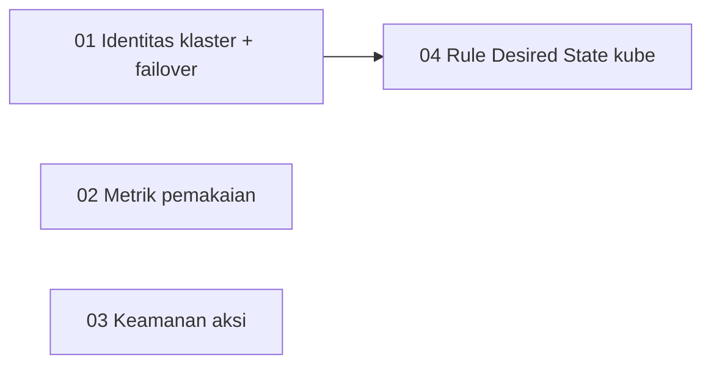

# Spec: Kubernetes Ops (Drift, Klaster, Metrik, Keamanan Aksi)

Status: needs-triage (rancangan; belum diimplementasi)
Dasar: [ADR 0043](../../docs/adr/0043-side-panel-and-kubernetes-k3s-rke2-management.md), [ADR 0025](../../docs/adr/0025-desired-state-rule-taxonomy-and-evaluators.md), [ADR 0006](../../docs/adr/0006-encrypted-system-snapshot-and-github-sync.md)

## Masalah

Fitur Kubernetes (ADR 0043) baru berupa klien `kubectl` interaktif. Empat celah:

1. **Tidak memantau.** Inti Pantau adalah Desired State + Drift, tetapi klaster tidak ikut Inspection, jadi node `NotReady` atau pod `CrashLoopBackOff` tidak memicu Alert.
2. **Satu klaster tampil N kali.** Klaster HA 3 node terdaftar sebagai 3 Host; memilih satu node yang mati menggagalkan semua permintaan padahal klaster sehat.
3. **Hanya kapasitas, bukan pemakaian.** Node menampilkan CPU/RAM terpasang, bukan yang terpakai.
4. **Aksi tanpa pengaman.** Exec = root shell di pod; scale ke 0, restart, cordon tanpa konfirmasi; Apply tanpa pratinjau perubahan.

## Hasil verifikasi pada klaster nyata (`odin`/`thor`/`loki`, k3s v1.36.5, read-only)

| Asumsi | Hasil |
|---|---|
| UID namespace `kube-system` sama di semua node | **Ya**, identik di ketiganya (`f52cb567-728a-4c51-819a-e501ea09a451`) → identitas klaster stabil |
| API metrik mentah tersedia dan cepat | **Ya**, `kc get --raw /apis/metrics.k8s.io/v1beta1/nodes` ≈ 0,14 s, JSON `NodeMetricsList` |
| `allocatable` vs `capacity` | Sama di klaster ini (`16107360Ki`); tetap pakai `allocatable` sebagai penyebut |
| `kc diff -f` read-only, exit code | **Ya**: exit 1 = ada perbedaan, tidak membuat objek (ConfigMap uji tetap `NotFound`) |
| Waktu kueri gabungan, perilaku tanpa metrics-server, `sudo` beda antar node | **Belum terverifikasi** (dari penalaran; tandai [INFERENCE]) |

## Keputusan desain (konservatif; ubah bila tidak setuju)

**A. Identitas klaster & failover** ([01](issues/01-cluster-identity-and-failover.md))
- Identitas = UID `kube-system` (`kc get ns kube-system -o jsonpath='{.metadata.uid}'`), dilipat ke `KubeDetect` tanpa round-trip SSH tambahan. Disimpan di kolom baru `hosts.kube_cluster_id` (bukan dihitung ulang tiap buka halaman: tanpa kolom, peer tak dikenal saat host utama mati).
- Pengisian **on-demand**: saat `detect` sukses pada sebuah Host, plus tombol *Detect clusters* di bagian Kubernetes (paralel terbatas, mengikuti pola worker pool inspeksi). Tidak ada auto-discovery di latar belakang.
- Picker mengelompokkan Host menurut `kube_cluster_id` → satu entri per klaster dengan jumlah node; sisanya "Standalone". Nama klaster = Host Group bersama anggota bila ada, selain itu nama Host pertama.
- Failover: hanya Host berperan `server`; urutan Host diminta → peer `healthy` → `degraded` (`sort_order, id`); peer `down` terakhir. Baca: boleh failover. Tulis (`action`, `apply`): failover **hanya** bila koneksi SSH ke Host utama gagal sebelum perintah apa pun berjalan. Respons selalu memuat `served_by_host_id/name`, `failover`, `primary_error` (aditif, kontrak lama tidak rusak); UI menampilkan chip *Gateway*.

**B. Metrik pemakaian** ([02](issues/02-usage-metrics.md))
- Sumber: API mentah `metrics.k8s.io` dalam skrip yang sama dengan `get nodes/pods` (bagian terpisah). Bukan `kubectl top` (teks tak stabil, lebih lambat).
- Field opsional `omitempty` pada `KubeNode`/`KubePod`; persen terhadap **allocatable**; pod tanpa persen (tanpa request/limit). Metrics-server absen/belum siap → field kosong, UI jatuh ke tampilan kapasitas, bukan galat.
- UI: dua kolom `CPU` dan `Memory` di Nodes (bar memakai `dockerBar`), dua kolom di Pods; memori lewat `formatKubeMemory` (GB). Tanpa polling.

**C. Keamanan aksi** ([03](issues/03-action-safety-kube-mode-confirm-diff.md))
- Satu kolom `hosts.kube_mode` ∈ `full` (default) | `no-exec` | `read-only`. Satu enum, bukan dua boolean, supaya keadaan mustahil tak bisa dibuat. Disimpan di `hosts` (bukan `settings`) karena kebijakan per Host; ikut Snapshot ([ADR 0006](../../docs/adr/0006-encrypted-system-snapshot-and-github-sync.md)) dengan default `full` untuk snapshot lama.
- Penegakan **di server**: `action`/`apply`/`diff-apply` ditolak 403 pada `read-only`; `exec-cmd` ditolak pada `no-exec` dan `read-only`; `/ws/terminal` menolak parameter `cmd` berisi `kubectl|kc … exec` serta preset serupa. **Batas jujur**: tidak bisa mencegat ketikan di PTY biasa. `no-exec` adalah pagar di tingkat aplikasi; batas keamanan sebenarnya tetap izin kubeconfig/sudoers/RBAC di Host. Harus tertulis di UI dan ADR.
- Log tetap boleh pada semua mode (pemecahan masalah read-only).
- Konfirmasi (`showConfirm`) dengan dampak konkret: scale ke 0, restart rollout, hapus Pod, cordon. Pesan StatefulSet menyebut PVC tetap ada.
- Apply: `POST …/kube/diff` (dry-run server lalu `kc diff -f`, exit 1 = ada perbedaan, bukan galat; output dipotong 256 KB). Tombol *Apply* terkunci sampai diff untuk **isi YAML saat ini** sudah dijalankan; mengubah teks mengunci lagi.

**D. Desired State untuk Kubernetes** ([04](issues/04-desired-state-kube-rules.md))
- `Kind = "kube"`, tanpa migrasi (`kind/target/expected` sudah `TEXT` bebas, Snapshot generik). Target: `node/<nama|*>`, `pod/<ns>/<prefiks|*>`, `<deployment|statefulset|daemonset>/<ns>/<nama>`, `pvc/<ns>/<nama|*>`. Expected: `Ready`, `running, restarts<=N`, `ready`, `Bound`.
- Satu kueri `kc get nodes,pods,deployments,statefulsets,daemonsets,pvc -A -o json` per Inspection, **hanya** pada Host yang punya rule `kube` aktif, `timeout 10s`, diurai sekali ke memori dan dipakai semua rule; Host tanpa rule `kube` tidak membayar apa pun.
- Wildcard menghasilkan **satu** Drift teragregasi per rule (cegah banjir Alert).
- Root Cause Excerpt hanya saat transisi ke drift: node → `describe node | tail`; pod → alasan/exit code + `logs --previous --tail 30` + events; workload/PVC → `describe | tail`.
- Baseline 1-klik: bila `KubeDetect` sukses → `node/*`=`Ready`, `pod/*`=`running, restarts<=10`, `pvc/*`=`Bound`, dan satu rule workload per Deployment di namespace non-sistem (`kube-system`, `kube-public`, `cattle-system` dikecualikan).
- `Completed`/`Succeeded` dianggap sehat untuk Pod milik Job.
- Dengan klaster HA, rule dievaluasi lewat failover (01); karena itu 04 diblokir oleh 01. Tanpa itu, reboot satu node memicu Alert palsu padahal klaster sehat.

## Urutan

02 dan 03 independen; keduanya dan 01 dapat dikerjakan paralel (hindari bentrok `index.html`: satu agen frontend per tahap, atau gabung 02+03 dalam satu agen UI).

## Risiko

- **Jejak `sudo` di log auth Host.** Kubeconfig k3s/RKE2 root-only, jadi setiap panggilan `kc` memicu `sudo -n`. Rule `kube` menambah satu entri per Inspection per Host. Mitigasi: evaluasi rule `kube` mengikuti interval Inspection dan Inspection Cooldown; operator dapat memperlebar interval atau menjalankan k3s dengan `write-kubeconfig-mode` yang lebih longgar (keputusan keamanan mereka).
- **Payload besar.** `get pods -A -o json` bisa >10 MB pada klaster padat; tetapkan batas (potong/abaikan metrik) dan uji pada klaster besar.
- **`sudo -n` berbeda antar node**: failover bisa gagal di tahap eskalasi pada peer tertentu; galat peer harus terlihat di `primary_error`/`served_by`.
- **Mutasi belum teruji di klaster nyata** (scale, restart, delete, cordon, apply); uji di namespace uji sebelum dipercaya.
- RKE2 belum teruji pada host nyata.

## Di luar cakupan

Drain node, edit/hapus resource sembarang, multi-klaster dengan kubeconfig eksternal, log streaming multi-pod, port-forward, RBAC multi-pengguna, penginterupsian ketikan PTY.

## Pertanyaan terbuka (jawaban bawaan di atas bila tidak dijawab)

1. Wildcard → satu Drift teragregasi per rule (bawaan) atau per pod?
2. Apply wajib melewati diff dulu (bawaan) atau Apply langsung + konfirmasi?
3. Nama klaster: Host Group/nama Host pertama (bawaan) atau kolom manual?
