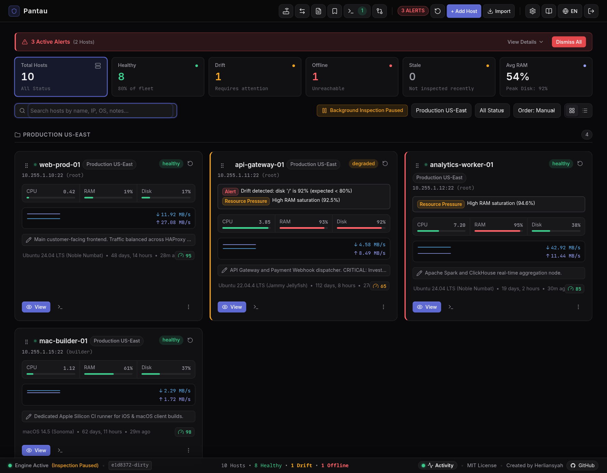

<p align="center">
  <a href="#readme">
    
  </a>
</p>

<h1 align="center">Pantau</h1>

<p align="center">
  <b>Agentless Linux & macOS Server Monitoring, Desired State Drift Engine & Interactive Management</b><br>
  <i>Single binary. Zero remote daemons. Embedded SQLite. Native SSH.</i>
</p>

<p align="center">
  <a href="README.md"><b>English</b></a> •
  <a href="README.id.md"><b>Bahasa Indonesia</b></a> •
  <a href="docs/user-guide.md"><b>📖 User Guide</b></a>
</p>

<p align="center">
  
  
  
  
  
</p>

<p align="center">
  
</p>

> [!WARNING]
> **Production & Security Advisory**: Pantau is an open-source administrative tool designed for server management and monitoring. It executes remote SSH commands, manages files via SFTP, and provisions keys directly on target Linux and macOS hosts with elevated/root privileges. This software is provided **"AS IS"** without warranties of any kind. Users are solely responsible for verifying operations, safeguarding private keys, and maintaining independent offline backups. Never expose Pantau to the public internet without proper authentication, reverse proxy protection, and TLS termination.

---

## 📖 Overview

**Pantau** is a self-hosted, lightweight, single-binary infrastructure monitoring and server management system built in Go. Unlike Prometheus/Node-Exporter, Zabbix, or Datadog, Pantau operates **100% agentless** over standard SSH (`port 22`). Target servers require **no background agents, no daemon installation, and no persistent telemetry scrapers**.

Pantau inspects remote hosts via non-interactive SSH commands, continuously validates systems against **Desired State** rules, diagnoses deviations with automatic **Root Cause Excerpts**, streams cross-host files in memory, and provides an in-browser Web Terminal (xterm.js) and SFTP Code Editor.

> [!TIP]
> **Administrator Playbook**: Looking for step-by-step operational workflows, disaster recovery procedures, or security hardening guides? Read the [Pantau Administrator Guide](docs/user-guide.md) ([Bahasa Indonesia](docs/user-guide.id.md)).

---

## 🏛️ Architecture

```
                                  +--------------------------------------------------+
                                  |                 Web Browser Client               |
                                  |     (Single-Page App, Fixed Shell, xterm.js)     |
                                  +------------------------+-------------------------+
                                                           | HTTP / WebSocket
                                                           v
+--------------------------------------------------------------------------------------------------------------------+
|                                                PANTAU CONTROL PLANE (Go)                                           |
|                                                                                                                    |
|  +---------------------+   +---------------------+   +---------------------+   +--------------------------------+  |
|  |   Inspection Loop   |   |   Drift Engine      |   |  Hybrid Alerting    |   | Cross-Host Transfer Engine     |  |
|  | (SSH Collector: 5m)|   | (Desired vs Actual) |   | (Telegram/Webhooks) |   | (Piped FIFO Stream, Zero-Disk) |  |
|  +----------+----------+   +----------+----------+   +----------+----------+   +---------------+----------------+  |
|             |                         |                         |                              |                   |
|             +-------------------------+------------+------------+                              |                   |
|                                                    |                                           |                   |
|                                       +------------v-------------+                             |                   |
|                                       | Embedded SQLite (WAL)    |                             |                   |
|                                       | Encrypted Snapshot/Argon2|                             |                   |
|                                       +------------+-------------+                             |                   |
+----------------------------------------------------|-------------------------------------------|-------------------+
                                                     | Native SSH Protocol                       | Stream Pipe
                                                     v                                           v
                       +-------------------------------------------+   +-------------------------------------------+
                       |           Remote Linux Host A             |   |           Remote macOS Host B             |
                       |  (Ubuntu / Debian / RHEL / CentOS 6-9)    |   |  (macOS 26 Tahoe / Apple Silicon / M-Series)  |
                       |  - POSIX Standard CLI Tools (`ps`, `df`)  |   |  - POSIX & Darwin CLI (`sysctl`, `vm_stat`)|
                       |  - Docker Engine / Containers             |   |  - APFS Shared Container Storage          |
                       |  - No Daemons / No Agents Installed       |   |  - No Daemons / No Agents Installed       |
                       +-------------------------------------------+   +-------------------------------------------+
```

---

## ✨ Key Features

### 1. 🔍 Agentless SSH Inspection & 1-Click Key Provisioning
- Collects real-time metrics (CPU Load, RAM, Disk partitions, Network Egress, Sockets, Uptime, Kernel) purely via standard POSIX SSH.
- **Hardware Specs & Resource Metrics**: Extracts hardware model, CPU core count, normalized CPU load, and virtual memory (Swap) status. Displays inline absolute capacity (`used / total`) on RAM and Disk progress bars, and dedicated Swap indicators on host cards.
- **Structured Inspection Runs & Telemetry**: Records per-host execution history (started timestamp, roundtrip duration in milliseconds, status badge, human-readable summary, and root cause diagnostic excerpts) in SQLite. Displays real-time execution duration metrics (`duration_ms`) on host cards and list views, with automatic inline rolling pruning maintaining a strict 100 runs limit per host with zero background schedulers.
- **Inspection Guard, Anti-Flood Cooldown & Hung NFS Protection**: Enforces a 15-second per-host cooldown on manual inspections (`HTTP 429 Too Many Requests`), an explicit in-flight concurrency lock (`HTTP 409 Conflict`), an enforced 45-second total hard timeout budget, and isolated local filesystem queries (`df -lPk /`) with 5-second execution timeouts to prevent hung NFS/network storage deadlocks.
- **One-Time Key Provisioning & Key Injection**: Provide target root/sudo password once in RAM. Pantau idempotently injects the public key (derived from the host's selected Library Key or the universal global public key) into `~/.ssh/authorized_keys` and discards the password immediately from memory.
- **Legacy Server Compatibility & TOFU**: Native cipher and host key fallbacks (`aes128-cbc`, `3des-cbc`, `diffie-hellman-group1-sha1`, `ssh-dss`, `ssh-rsa`) allow monitoring legacy Linux servers (CentOS 5/6, Debian 7, OpenSSH 4.3+). Built-in TOFU (Trust-On-First-Use) automatically records host fingerprints upon initial handshake while guarding against MITM attacks.
- **Mass Inspection & Freshness Indicators**: Trigger simultaneous bulk inspection across all hosts via `⚡ Inspect All` running through a bounded worker pool (max 5 parallel host sessions) with an anti-flood lock, configurable background inspection intervals (with `0` seconds support to pause/disable background worker for pure on-demand manual inspection), dynamic time-ago indicators, and automated Stale Inspection warnings with pause suppression.

### 2. 📋 Desired State Baseline & Automated Drift Engine
- **1-Click Baseline**: Auto-detects running Docker containers, disks, cron jobs, and database services (`mysqld`, `postgres`, `redis`, `nginx`).
- **Real-Time Drift Detection**: Alerts when a container crashes, disk exceeds threshold (e.g. `> 85%`), cron job disappears, or backup becomes stale.

### 3. 🩺 Root Cause Excerpt Diagnostic Capture
- When a service or container crashes, Pantau captures the exact fault context:
  - Docker container exit code & `OOMKilled` memory termination flag.
  - Tail 50 lines of crash output from `journalctl -u <service>` or `docker logs <container>`.
- Displays incident diagnostic timelines directly inside the host workspace modal.

### 4. 🚀 Piped Cross-Host Streaming Transfer
- Stream files and folders between two remote hosts directly through memory pipes without spooling to Pantau's local disk.
- **Fast Stream Mode**: Maximizes throughput via `tar` streaming pipes.
- **Verified Mode**: Computes and verifies SHA256 checksums end-to-end on both source and destination hosts before reporting completion.

### 5. 🛡️ Network & Disk I/O Observability
- **Real-Time Disk I/O Rates (Speedometer)**: Extracts real-time disk read/write throughput rates (B/s) and cumulative volume directly via `/proc/diskstats` without `iostat` dependencies, featuring reboot rollover protection and qualitative load status badges (Optimal `< 10 MB/s`, Active `10–80 MB/s`, High I/O Load `≥ 80 MB/s`).
- **Internet Egress & Latency**: Tests outbound connectivity and ping latency to global DNS resolvers (`1.1.1.1`).
- **Live Active Sockets**: Aggregates top connected remote IP addresses and established connections.
- **Brute-Force & Failed Login Counter**: Detects SSH brute-force attacks via `/var/log/auth.log` or `journalctl _SYSTEMD_UNIT=ssh.service`.
- **Attack Surface Classification**: Highlights open listening ports, binding addresses (`0.0.0.0` vs `127.0.0.1`), and tags risk levels (Public Internet vs Localhost).

### 6. 🔐 Encrypted System Snapshot & GitHub Disaster Recovery
- Encrypts all host configurations, SSH credentials, and desired state baselines into portable `.enc` snapshots using **Argon2id** key derivation and **AES-256-GCM** authenticated encryption.
- **Automated GitHub Sync**: Push encrypted snapshots to a private GitHub repository on a scheduled interval.
- **Disaster Recovery Wizard**: Rebuild an entire monitoring cluster from scratch using a GitHub token + repository path or a raw `.enc` file.

### 7. 💻 Interactive Web Terminal & SFTP File Manager
- **Web Terminal**: In-browser interactive shell powered by `xterm.js` over WebSocket SSH PTY sessions with full ANSI color, terminal resize support, and safe clipboard bridge.
- **SFTP Explorer & Code Editor**: Navigate remote directories with clickable breadcrumbs, sort by columns, filter by categories, duplicate files/folders with automatic disk space safety verification, and edit scripts with full-viewport CodeMirror maximize in a modern VS Code Dark+ theme.
- **Elevated File Access**: Switch access to `root` or another user via passwordless `sudo -n -u` to explore, edit, upload, download, or duplicate files in restricted directories with clear visual badges and Activity Console auditing.

### 8. 🌐 Dual Language Interface (English & Bahasa Indonesia)
- Instant client-side localization switcher (`🌐 EN` / `🌐 ID`) in the header.
- Zero-dependency local translation dictionary stored in `localStorage` (default: English).
- Canonical domain terminology preserved in Indonesian version for clear operational communication.

### 9. 🩺 Transparent 6-Factor Lifecycle Assessment & Hardware Refresh
- Evaluates server operational health across 6 transparent factors: Linux OS End-of-Life (EOL) status, hardware age & MTBF degradation (bare-metal BIOS date vs cloud VM OS deployment age), RAM pressure, CPU core-to-load saturation, disk capacity, and kernel I/O errors.
- **Productive Lifespan Guidance**: Automatically flags servers exceeding standard 3–5 year hardware amortization or 8-year critical lifespans, providing auditable checklist breakdowns and formal hardware refresh justifications.

### 10. 🛡️ Airgapped & Self-Contained Web Assets (Zero-CDN)
- 100% of frontend vendor libraries (`xterm.js`, `xterm-addon-fit`, and `CodeMirror` with 8 syntax modes: XML, JS, CSS, HTML, C-like, PHP, Shell, YAML) are bundled directly inside the single binary via `go:embed`.
- Enforces a strict Content Security Policy (CSP) with zero external CDN network requests, guaranteeing full offline operations in isolated intranets, airgapped VPCs, or disconnected environments.

### 11. 📂 Host Grouping, Terminal Maximize & Port Auto-Scan
- **Host Grouping**: Categorize hosts by environment or role (e.g. *Primary Cluster*, *Testing*, *Database Servers*) with unified grid and list view separation.
- **Terminal Maximize**: Expand the web terminal to a full-viewport canvas while preserving interactive terminal shortcuts (such as `Esc` in `vim`, `nano`, or `htop`).
- **Port Auto-Scan Fallback**: Automatically scans sequential ports (`8080` to `8099`) when initialized on the default port, eliminating startup crashes caused by busy ports.

### 12. ⚡ Terminal Presets & Split-Pane Observability
- **Terminal Presets**: Save and execute recurring diagnostic commands (`htop`, `docker stats`, `journalctl -f`) with pre-flight availability checks.
- **Split-Pane Web Terminal**: Launch dual side-by-side terminal sessions (`Alt+\`) to monitor and compare multiple remote hosts simultaneously in real time.

### 13. 🔐 Airgapped TOTP Two-Factor Authentication (2FA) & Emergency Recovery
- **Standard RFC 6238 TOTP**: Hardens administrator login using time-based one-time passwords compatible with any standard authenticator app (Google Authenticator, Aegis, 1Password, Bitwarden).
- **100% Offline Enrollment**: Base32 secrets and QR codes are generated purely client-side with zero external API calls or telemetry leaks.
- **Emergency Recovery Codes**: Generates 8 single-use recovery codes with instant copy and text file download for disaster recovery.
- **Brute-Force Rate Limiting**: Enforces an automatic 30-second cooling lockout after 3 consecutive failed verification attempts.
- **Host Bypass Flag**: Emergency `-disable-2fa` startup flag disables 2FA directly via the host master console if all credentials are lost.

### 14. 🖥️ Global Multi-Tab Terminal Dock & Terminal Header Launcher
- **Multi-Tab Terminal Dock**: Persistent application-wide dock hosting multiple concurrent SSH PTY terminal sessions across different remote servers with inline tab renaming and split-pane view (`Alt+\`).
- **Terminal Header Launcher**: Integrated global launcher on the application header with a real-time active session badge. Acts as a smart toggle to minimize, restore, or quickly launch terminal sessions with a server picker dropdown.
- **Reactive Host Session Badges**: Host cards in Grid and List views display live shell session count badges, showing at a glance which servers have active terminals running.
- **Seamless Maximize & Hierarchical Navigation**: One-click maximize to full viewport without disconnecting SSH sessions; stacked modal layering and sequential `Escape` dismissal preserve terminal navigation.

### 15. 🔄 Update Checker & Zero-Ops Semi-Automatic Self-Update
- **Asynchronous Update Checker & CLI Release Notes**: Periodically checks for upstream GitHub Releases (every 12 hours with 6-hour cache TTL) and displays update indicators on the web dashboard. Running `pantau -check-update` in the terminal fetches the latest release, prints the download URL, and renders formatted release notes directly to stdout.
- **SHA-256 Integrity Verification**: Validates downloaded release archives against official `checksums.txt` manifests before unpacking.
- **Pre-flight Smoke Test & Rollback**: Verifies candidate binary execution (`pantau.tmp -v`) prior to swapping; immediately aborts if any architecture or runtime incompatibility is detected.
- **Cross-Platform Atomic Swap**: In-place replacement on Linux and Windows (using `.exe.old` renaming to bypass OS executable file locking).
- **Graceful Process Handover**: Zero-data-loss restart preserving CLI flags and database state, utilizing `instance.AcquireWithTimeout` (up to 3s retry) to seamlessly hand over the database lock from the terminating parent to the newly spawned child process without collision, paired with auto-reconnecting browser clients.
- **Airgapped-First & Docker Awareness**: Fails silently in airgapped environments (with `-disable-update-check` flag), and intelligently detects Docker containers to display `docker compose pull` recommendations instead of binary swapping.

### 16. 📖 Airgapped In-App Documentation Modal & Embedded Changelog
- **Embedded Single-Source Guides**: Pantau's official README, User Guide (bilingual EN/ID), and Changelog are embedded directly inside the single binary via `go:embed`.
- **Zero-Dependency In-App Reader**: Read operational guides offline without internet or external CDN dependencies via the **Documentation Modal** (`75vw × 80vh`), featuring an integrated micro-parser, theme-aware syntax styling, and smooth-scrolling dynamic Table of Contents.
- **Dual Entry Point**: Accessible before login on initial setup and disaster recovery screens, as well as post-authentication via header `(?)`, footer version badge, and Settings links.

### 17. ⚡ In-App Activity Console & Live Event Stream
- **Real-Time Operational Observability**: Stream live runtime daemon and subsystem operations (`inspect`, `ssh`, `transfer`, `terminal`, `snapshot`, `system`, and `auth`) directly to the browser via zero-dependency Server-Sent Events (`GET /api/logs/stream`).
- **Telemetry Ring Buffer**: In-memory fixed-capacity ring buffer (100 records) and non-blocking broadcaster wrapping Go standard library `log/slog` for instant cold-start operational context.
- **Redaction Filter**: Deterministic boundary filter automatically sanitizing SSH passwords, private keys, authentication tokens, passphrases, and 2FA secrets into `[REDACTED]`.
- **Collapsible Activity Console Drawer**: Bottom diagnostic drawer docked above the footer with a 5-column running table (`Time`, `Level`, `Module`, `Host`, `Message & Details`), expandable attribute cards, Smart Auto-Scroll, pause/resume freeze toggle, severity level filtering (`ALL`, `ERROR`, `WARN`, `INFO`), instant search, and client-side `.log` / `.json` file export.
- **Footer Trigger & Global Shortcut**: Triggered via footer button `⚡ Activity` with live pulse indicator, unread error counter badge, or global shortcut `Ctrl + \`` (backtick).
- **Zero-Waste Performance Throttling**: Skips 100% of DOM manipulation when the drawer is closed and coalesces incoming events with `requestAnimationFrame` when open to eliminate CPU waste and layout thrashing.

### 18. ⚡ Top Resource Consumers & Process Telemetry
- **Agentless Process Observability**: Continuously extracts top 5 resource-consuming processes across three dimensions—Top CPU (`%cpu`), Top Physical Memory (`rss`), and Top Virtual Memory (Swap)—during every standard inspection cycle without running background remote daemons. On Linux, Top CPU reflects current usage sampled across a ~1 s window per inspection (% of one core, up to >100% for multi-threaded processes) rather than lifetime average `ps %cpu`, while macOS tracks recent usage via `ps -Aro`. On environments whose `ps` lacks `--sort` (e.g. BusyBox/Alpine), Pantau sorts processes internally so the true top 5 are always displayed.
- **Conditional Swap Scanner**: Low-overhead `/proc/[0-9]*/status` VmSwap extraction executed conditionally only when swap memory usage is detected (`SwapUsedBytes > 0`), resolving system usernames from `/etc/passwd` (falling back to numeric UID only if unresolvable) and avoiding CPU churn on systems with swap unconfigured.
- **Overview Telemetry Widget**: Responsive 3-column process card inside the Host Detail Overview tab showing PID, user name, memory footprint, and command details, paired with a direct one-click launcher to open the interactive Terminal Dock.

### 19. 📦 Polyglot Package Inventory & Software Hygiene
- **Agentless Multi-Distro Inventory**: Discovers installed system software across Debian/Ubuntu (`dpkg-query`), RHEL/CentOS/AlmaLinux/Rocky (`rpm`), Alpine (`apk`), and Arch (`pacman`) via native zero-dependency CLI inspection.
- **Software Hygiene & Dormant Detection**: Automatically categorizes packages into **Manual Install** (explicitly requested by operators) vs **Base System** (OS distro baseline/dependencies), and flags **Dormant Packages** whose associated systemd service units remain inactive, disabled, or failed.
- **Dedicated Packages Tab & Guardrails**: Integrated package exploration tab in the Workspace Modal with instant text search, category filters (`⭐ Manual Install`, `💤 Dormant Packages`, `📋 All Packages`), on-demand rescan button with a 30-second anti-flood cooldown timer (`HTTP 429`), and background concurrency locking (`HTTP 409`).

### 20. 🌐 Agentless Network Diagnostics & Hop Analysis
- **On-Demand Diagnostic Probes**: Real-time interactive Ping, Traceroute (with tracepath auto-fallback), zero-dependency TCP Port Probe (`/dev/tcp`), and DNS Resolve streamed directly over Server-Sent Events (SSE).
- **Automated Hop Analysis**: Categorizes network hops into Local/Private VPC, ISP Transit, and Destination zones, with automated blackhole packet drop detection and latency jump alerts (>60ms).
- **Concurrency & Human-Error Protection**: Singleflight guard prevents concurrent diagnostic tasks per source host, while target selection automatically disables unreachable/offline hosts.

### 21. ⚖️ Multi-Host Side-by-Side Comparison & Scoring Matrix
- **Head-to-Head Comparative Matrix**: Side-by-side interactive evaluation comparing 2 to 4 hosts inside a dedicated Workspace Modal using client-side inspection telemetry.
- **Standardized Multi-Category Scoring**: Evaluates hosts across Compute, Storage & I/O, Network Health, and System Hygiene & Lifecycle with a 5% deadband noise filter and stale-host penalty.
- **Automated Decision Synthesis & Export**: Generates executive workload placement recommendations and one-click formatted Markdown summaries for stakeholder reports.

### 22. 📌 File Pinning with Notes & Global Bookmarks
- **Operational File & Directory Pinning**: Pin critical configuration files and log paths per host with contextual operator notes and visual badges.
- **Quick Access & Global Bookmarks**: Instant access via the file manager Quick Access toolbar or globally across all hosts through the header `🔖 Bookmarks` launcher.
- **Cross-Host Navigation & Terminal Jump**: Search pinned files globally, open them in the integrated code editor, or launch a Terminal Dock session straight into the parent directory.

### 23. ⚡ Terminal Presets Live Search & Pinned Paths Quick-Access
- **Terminal Presets Live Search**: Instant real-time filtering in the terminal presets dropdown by preset title, command, or tmux session tag (`t:tag`), enabling rapid command execution across extensive preset catalogs.
- **Terminal Pinned Paths Dropdown**: Dedicated Quick-Access dropdown (`📌`) directly in the terminal toolbar listing all pinned files and directories for the active host with real-time path & note search filtering, 1-click `cd` directory jump, and quoted path injection into the shell session.
- **Streamlined Terminal Toolbar & Direct Navigation**: Clean toolbar layout with host status badge, font zoom controls (`+`/`-`/`0`), 1-click context jump to Host File Manager (`📁 Files`), and split-pane controls (`⬛ Split`).
- **Active Working Directory Tracking**: Real-time tracking of remote shell working directory via shell window titles and OSC 7 ANSI escape sequences.

### 24. 🌐 Terminal Link Detection, Remote Browser Bridge & Web Port Tunneling
- **Interactive Terminal Links**: Native link detection in `xterm.js` via `term.registerLinkProvider` without third-party vendor bloat. Supports `Ctrl+Click` (Linux/Windows) and `Cmd+Click` (macOS) to open public URLs directly in new browser tabs without interfering with terminal text selection.
- **Remote Web Port Tunneling**: Agentless HTTP and WebSocket reverse proxy (`/api/tunnel/:hostId/:port/*`) streaming over OpenSSH RFC 4254 `direct-tcpip` channels (`golang.org/x/crypto/ssh` `DialContext`). Access remote private web applications (`localhost:port` or `127.0.0.1:port`) securely from your desktop browser without exposing public firewall ports.
- **Zero-Handshake Connection Pooling**: Caches SSH tunnel transports per host with transparent auto-reconnect fallback, eliminating 100–300ms connection latency across sequential web assets (CSS, JS, images).
- **Native WebSocket Hijacking**: Full-duplex bidirectional streaming supporting HTTP status `101 Switching Protocols` out of the box for modern development servers (Vite HMR, Next.js, Jupyter).
- **Zero-Configuration Remote Browser Bridge**: Automated OSC 1337 (`OpenURL`) and OSC 777 escape sequence receiver routing CLI tool browser requests (`gh auth login`, `xdg-open`, Python `webbrowser`, AWS SSO, `npm login`) directly to the client's desktop browser without headless text-browser (`w3m`/`lynx`) traps.
- **Silent Shell Environment Auto-Provisioning**: Non-intrusive provisioning of `/tmp/pantau-browser` and silent environment injection (`BROWSER`, `GH_BROWSER`) across login shells with zero console echo.
- **Terminal Ports Dropdown & Action Modal**: Dedicated `🌐 Ports` toolbar menu in the terminal dock for manual port forwarding entry and persistent recent port history (`localStorage`), paired with an interactive confirmation modal on clicking remote localhost URLs in terminal output.

### 25. 🔑 Centralized SSH Key Library & Deterministic Resolution
- **Centralized SSH Key Library**: Register and manage reusable private keys once under **Settings → SSH Keys**; assign them across any number of hosts through a simple dropdown in the host creation/edit modal.
- **Deterministic Key Resolution Hierarchy**: Enforces a strict multi-tier fallback order across all SSH operations: assigned Library Key (`key_id > 0`) → host-specific Custom Key (`custom_key`) → global default key (`settings.ssh_private_key`). If a host references a missing or deleted library key, Pantau fails explicitly rather than falling back silently.
- **Automated Public Key & Fingerprint Derivation**: Automatically parses private keys with `golang.org/x/crypto/ssh` on entry, deriving the standard OpenSSH public key (`authorized_keys` format) and SHA-256 fingerprint (`SHA256:...`). Passphrase-protected keys are explicitly rejected with clear guidance.
- **Zero-Credential-Leakage & Safety Controls**: Private keys are never serialized to the REST API (`GET /api/ssh-keys` returns metadata only) and are deterministically scrubbed from system logs (`[REDACTED]`). Key deletion is protected and strictly refused (`HTTP 409 Conflict`) while any host still references the key (`used_by > 0`).
- **Encrypted Snapshot Resilience**: All registered library keys are included in encrypted System Snapshots (AES-256-GCM), preserving host key associations during cluster backups and bare-metal disaster recovery.

### 26. 🛡️ Agentless Host Security Scan & Hardening Checks
- **Agentless Security Patch Discovery**: Identifies pending security updates on Debian/Ubuntu (`apt`), RHEL/CentOS/AlmaLinux/Rocky/Fedora/Amazon Linux (`dnf`/`yum`) via read-only remote commands without requiring root/sudo privileges or agent installations.
- **Severity & Advisory Visibility**: Extracts upstream vulnerability severities (`Critical`, `Important`, `Moderate`, `Low`) and advisory references (RHSA/ALAS/CVE) for dnf/yum, while tracking apt security updates with explicit `unknown` severity transparency.
- **Reboot & Repo Cache Freshness**: Automatically detects reboot requirements (`/var/run/reboot-required` or `needs-restarting -r`) and repository metadata age, warning operators when cache is stale (>7 days) rather than falsely reporting zero pending updates.
- **Essential Read-Only Hardening Checks**: Audits 4 vital baseline security controls: OpenSSH root login policy (`sshd_permit_root_login`), SSH password authentication (`sshd_password_auth`), automatic security update timers (`auto_security_updates`), and host firewall state (`firewall_active`).
- **Honest-Coverage Architecture**: Enforces a strict honesty rule—systems with unsupported distributions (Alpine, Arch, etc.), unreadable configurations, or stale caches report clear status (`partial`, `unsupported`) and detailed coverage notes instead of a deceptive clean bill of health.
- **Continuous Compliance via Desired Rules**: Declare `security_updates` rules (target `security`, expected `none` or `<=N`) evaluated against the cached scan without live SSH overhead, triggering automated drift alerts when security updates accumulate, scans exceed 72 hours, or coverage is unverified.
- **Airgapped-Ready & Zero CVE Bloat**: 100% functional in isolated networks without outbound internet access or external vulnerability database dependencies; scan results are stored in SQLite and excluded from encrypted snapshots as reproducible telemetry.

### 27. 🍎 First-Class macOS (Darwin) Host Support
- **Agentless Darwin Observability**: Extends full agentless monitoring to macOS hosts (Apple silicon Mac mini, Mac Studio, Mac Pro) over standard OpenSSH with zero remote daemons or background agents.
- **Activity Monitor-Accurate RAM & APFS Storage**: Computes physical memory using Apple's official Activity Monitor formula `(Anonymous - Purgeable + Wired + Compressor) * pagesize` from `vm_stat` alongside swap usage from `sysctl vm.swapusage`. Accurately measures shared APFS storage via `/System/Volumes/Data` (`used = total - available`) rather than the sealed root volume.
- **Hardware Telemetry & Physical Network Egress**: Discovers chip and hardware model (e.g. `Apple Mac Studio (Mac15,14) - Apple M3 Ultra`), total CPU cores, and system install birthtime. Sums cumulative disk I/O bytes via `ioreg` storage driver statistics and isolates physical `en*` interfaces via `netstat -ibn` without virtual interface distortion.
- **Privacy-First Process Telemetry (`ucomm`)**: Enforces short process name extraction (`ps -o ucomm`) across CPU and memory tables, guaranteeing sensitive tokens, flags, or secrets in command-line arguments are never captured or leaked.
- **macOS Security & Hardening Assessment**: Audits pending system updates via `/usr/sbin/softwareupdate` with honest `partial` reporting on network timeouts, coupled with 4 native hardening checks: OpenSSH root login, password authentication, automatic software update preferences (`com.apple.SoftwareUpdate`), and application firewall state.
- **Continuous Desired State & Portable Diagnostics**: Validates APFS disk thresholds, `launchd` services, listening ports via `lsof`, and backup freshness via BSD `stat -f`. Runs network latency probes and traceroute using native Darwin tooling without external package installation.
- **Zero Linux Regressions**: Built with strict isolation (`uname -s` runtime branch); Linux inspection workflows remain 100% byte-for-byte unchanged.

### 28. ☸️ Kubernetes Cluster Management (k3s, RKE2 & External Kubeconfig)
- **Agentless k3s / RKE2 Control-Plane Inspection**: Inspect nodes, workloads (Deployments, StatefulSets, DaemonSets), pods, services, ingresses, configmaps, persistent volumes, jobs, and events over standard SSH using the host's existing `kubectl` with passwordless sudo fallback when kubeconfig requires elevation.
- **External Clusters via Kubeconfig (EKS, GKE, AKS & Remote)**: Register external or managed cloud Kubernetes clusters by pasting or uploading a kubeconfig. Runs commands via local `kubectl` subprocess on the Pantau server while preserving all telemetry views, YAML editing with server diff gates, live WebSocket logs, and lifecycle actions.
- **Secure Kubeconfig Intake**: Validates inputs up to 128 KB, minifies to single-context JSON, strictly rejects arbitrary local file-path credentials (`tokenFile`, `client-key`, etc.), and restricts `exec` credential plugins to a strict allowlist (`aws`, `gke-gcloud-auth-plugin`, `kubelogin`, `az`, `doctl`, `oci`).
- **Action Safety & Guardrails**: Enforce per-cluster policies (`full`, `no-exec`, or `read-only`), concrete impact confirmations for scale-to-0, rollout restart, pod deletion, and node cordon/drain.

### 29. ☁️ Cloudflare Management via REST API v4
- **Direct Account & Zone Management**: Manage multiple Cloudflare accounts and explore zones directly from Pantau's web interface without external dependencies, SDK bloat, or Global API Keys.
- **DNS Records Lifecycle**: Comprehensive view and search across DNS records (A, AAAA, CNAME, TXT, MX, NS, SRV, CAA). Add, edit, and delete records with inline proxied toggle (Cloudflare orange cloud proxying).
- **Cache Purge Controls**: Instant cache clearing with two dedicated modes: Purge Everything (with confirmation guardrail) and Purge by URL (up to 30 URLs per batch).
- **Curated Zone Settings Allowlist**: Safely toggle essential security and performance options: SSL Mode (`off`, `flexible`, `full`, `strict`), Always Use HTTPS, Security Level, Development Mode, Minimum TLS Version, and Automatic HTTPS Rewrites.
- **Zero-Exposure Credential Safety**: Scoped API Tokens are stored securely in SQLite like SSH private keys, excluded from API JSON responses, and protected inside encrypted System Snapshots.

### 30. 📜 Ansible Playbooks (Semaphore-Style, Agentless)
- **Dynamic Inventory from Existing Fleet**: Execute Ansible Playbooks against target hosts and groups with zero static inventory files. Pantau automatically generates JSON inventories on the fly combining host addresses, SSH users, ports, and credentials from the SSH Key Library.
- **Local CLI Execution Engine**: Executes playbooks via local `ansible-playbook` CLI on the Pantau server with live stdout/stderr streaming into an in-browser log viewer (polling byte offset every 1s with smart auto-scroll).
- **Multi-Mode Operations**: Supports standard `run`, dry-run simulation (`check`), change comparison (`diff`), and syntax validation (`syntax`).
- **Administrative Ansible Gate & Security Isolation**: Guarded by an explicit opt-in switch (`ansible_enabled`). Runs execute in sterile child environments with isolated `0600` private key files in `0700` temporary workspaces that are guaranteed wiped upon run completion, cancellation, or error.
- **Rolling History & Snapshot Safety**: Automatically retains the latest 100 finished runs per playbook. Playbook definitions are backed up into AES-256-GCM encrypted System Snapshots.
- **Git Playbook Source & In-App Editor**: Run playbooks straight from a Git repository (`https://`, `ssh://` or `user@host:path`, branch/tag, per-repo path, none / access token / SSH Key Library auth). The repo is shallow-cloned per run so `roles/`, `group_vars/` and `files/` work; tokens never appear in args, logs or API responses, and the commit that ran is recorded in the run history. Operators can browse repository files, edit, create, delete, and commit & push changes directly from the dashboard via the **Git Editor** modal (requires write-permission credentials; optimistic concurrency protects against upstream changes).
- **Import Folder**: Pick a local folder, see which YAML files are real playbooks, and import the ones you tick like the host import. The YAML is copied into Pantau as ordinary playbooks you then edit there, together with their variables (add, edit, delete); nothing of the folder is kept. Roles and collections come from the Library, the inventory is generated by Pantau, and `ansible.cfg` options live in Ansible Settings. Review the files for secrets before importing.
- **Library & Ansible Configuration**: Install collections and roles from Ansible Galaxy (name/version or `requirements.yml`) or import them from local folders/tarballs; they are shared by every playbook instead of being vendored into each project. Global `ansible.cfg` additions (forks, pipelining, interpreter, become method, …) are edited in Ansible Settings; Pantau-managed keys are rejected.
- **Cron Schedules**: Run playbooks unattended on a 5-field cron expression (server local time) against fixed Hosts or a Host Group, in any mode. Occurrences missed while Pantau was down or the Ansible Gate was off are skipped, never replayed.
- **Run Insight** ([ADR-0057](docs/adr/0057-ansible-ops-recap-tasktree-diff-survey-adhoc-facts-explorer.md)): playbook logs are ANSI-colored and the run viewer switches between the raw **Log**, a **Task Tree** (Play > Task > Host with search and status filter), a **Play Recap** bar per host (ok, changed, unreachable, failed, skipped) and a per-file **Diff** view. The recap is parsed server-side and saved with the run, and the history shows a mini recap bar.
- **Limit & Verbosity 0..4**: narrow a run or schedule with an Ansible host pattern (`--limit`, validated against `^[A-Za-z0-9_.,:!&*\[\]-]{1,256}$`, so only Generated Inventory aliases and Host Groups are addressable) and raise verbosity up to `-vvvv`.
- **Survey**: give a playbook a typed questionnaire (`text`, `textarea`, `number`, `integer`, `select`, `multiselect`, `boolean`, `password`) that the launch dialog renders and the server validates. Answers override the playbook's default extra vars while explicit launch extra vars still win; `password` answers are never stored with the run (though a task that prints them will show them in the log).
- **Ad-Hoc Runner**: run a single module (`ping`, `shell`, `command`, `apt`, `service`, `setup`, …) against Hosts or a Host Group without writing a playbook, with live log, per-host result table and its own 100-entry history. Up to 3 ad-hoc runs at once, counted separately from playbook runs.
- **Facts & Host Explorer**: a new **Hosts** tab mirrors the Generated Inventory as a Group > Host tree with Pantau health badges, a **Ping** button (Reachable / Unreachable / Failed) and a **Facts** viewer that caches `setup` output per host (OS, CPU, memory, disks, network, plus raw JSON) — facts are a cache and stay out of System Snapshots.
- **Git Sync**: check a Git-sourced playbook on demand — Pantau shallow-clones it, confirms the playbook path and reports the commit, branch and YAML files, remembering the last synced commit and time.
- **Playbook Grouping**: Organize playbooks into collapsible visual sections and filter them by group using a free-text `group_name` (modeled after Host Groups, cosmetic only, saved in System Snapshots).

### 31. 🏗️ Terraform Management (Terraform Cloud-Style, Local CLI)
- **Local CLI Execution Engine**: Manage Terraform and OpenTofu infrastructure through local `terraform` or `tofu` binaries on the Pantau server with real-time stdout/stderr log streaming and visual plan inspection.
- **Complete Run Lifecycle & Approval Gate**: Enforces a structured pipeline (`plan` → built-in `policy check` → optional `cost estimate` → `approval gate` → `apply`). Runs with changes require mandatory administrative comments (`Confirm & Apply` or `Discard`) and policy override protection.
- **Immutable State Versioning, Diff & Rollback**: State files are persisted in SQLite and materialized locally before runs. Features a pure-Go v4 state parser, resource inventory, visual state diffing, raw `.tfstate` download, and safe rollback (`current.serial + 1`).
- **Workspace Locks & Concurrency Guards**: Automatic run-level locking (`locked_by = "run:<id>"`), manual administrative locking, and emergency Force Unlock. Max 1 active run per workspace and 3 active runs globally.
- **Variables & Reusable Variable Sets**: Manage `terraform` and `env` variables with scalar or HCL values. Sensitive variables are write-only (`(sensitive)` in logs, `json:"-"` in API). Share common variables across multiple workspaces or globally via Variable Sets.
- **Built-in Policy as Code & Cost Estimation**: Enforce operational guardrails without OPA (`deny_destroy`, `max_deletes`, `max_changes`, `deny_resource_types`, `require_tags`, `deny_open_cidr`) with `advisory`, `soft`, and `hard` enforcement. Infracost CLI integration provides automated monthly cost delta breakdowns when installed.
- **Scheduled Drift Detection**: Automated background scheduler executes speculative `-refresh-only` plans at configurable intervals to detect real-world infrastructure drift against state.
- **Private Module Catalog**: Browse internal module documentation, input/output declarations, required providers, and copyable `module "x" { ... }` usage snippets parsed from inline files or Git repos.
- **Git VCS, Webhook Automation & In-App Editor**: Connect workspaces to Git repositories (shallow clone, branch tracking, subdirectories, token/SSH auth) and trigger speculative plans automatically via secure webhooks with constant-time HMAC / secret token verification. Use the built-in **Git Editor** in Workspace Settings to view repository files, edit configurations, and commit & push updates directly to the tracked branch or a new branch (strictly non-force push, guarded by write-permission credentials).
- **Administrative Terraform Gate & Snapshot Safety**: Guarded by an explicit opt-in switch (`terraform_enabled`). Workspaces, variables, variable sets, policies, modules, and latest states are backed up inside encrypted System Snapshots.
- **Workspace Grouping**: Organize workspaces into collapsible visual sections and filter them by group using a free-text `group_name` (modeled after Host Groups, cosmetic only, saved in System Snapshots).

---

## 🚀 Quick Start

### Option 1: Standalone Binary (Fastest)

Download the latest binary for your architecture from [GitHub Releases](https://github.com/herliansyah/pantau/releases):

```bash
# Make binary executable
chmod +x pantau

# Run Pantau with custom port and data directory
./pantau -port 8080 -db data/pantau.db
```

Open `http://localhost:8080` in your web browser.  
**Default Password**: `admin` *(change immediately in Settings)*.

---

### Option 2: Docker Compose

```yaml
version: "3.8"

services:
  pantau:
    image: ghcr.io/herliansyah/pantau:latest
    container_name: pantau
    restart: unless-stopped
    ports:
      - "8080:8080"
    volumes:
      - pantau-data:/data
    environment:
      - PANTAU_PORT=8080
      - PANTAU_DB=/data/pantau.db

volumes:
  pantau-data:
```

*(Note: Official Docker images on GHCR are multi-architecture, supporting both `linux/amd64` and `linux/arm64` natively. Standard `PORT` and `DB_PATH` environment variables are also supported as automatic fallbacks).*

```bash
docker compose up -d
```


---

### Option 3: Systemd Service (Linux Production)

Create `/etc/systemd/system/pantau.service`:

```ini
[Unit]
Description=Pantau Server Monitoring & Management
After=network.target

[Service]
Type=simple
User=root
WorkingDirectory=/opt/pantau
ExecStart=/opt/pantau/pantau -port 8080 -db /opt/pantau/data/pantau.db
Restart=always
RestartSec=5
LimitNOFILE=65535

[Install]
WantedBy=multi-user.target
```

```bash
systemctl daemon-reload
systemctl enable --now pantau
```

---

## ⚙️ Configuration Reference

| Flag | Env Variable | Default | Description |
| :--- | :--- | :--- | :--- |
| `-port` | `PANTAU_PORT` (or `PORT`) | `8080` | HTTP listening port (auto-scans `8080`–`8099` on default) |
| `-db` | `PANTAU_DB` (or `DB_PATH`) | `pantau.db` | Path to SQLite database file |
| `-open` | - | `true` (Windows) / `false` | Automatically open default web browser on launch |
| `-disable-2fa` | - | `false` | Emergency bypass flag to disable TOTP 2FA directly from host terminal |
| `-check-update` | - | `false` | Check for latest upstream release version, print release notes, and exit |
| `-update` | - | `false` | Update Pantau executable to latest release and exit |
| `-disable-update-check` | `PANTAU_DISABLE_UPDATE_CHECK` | `false` | Disable background update checker (recommended for airgapped environments) |
| `-log-level` | `PANTAU_LOG_LEVEL` | `error` | Console log level (`debug`, `info`, `warn`, `error`, `off`) |
| `-q`, `-quiet` | - | `false` | Suppress non-error console logs (shorthand for `-log-level=error`) |
| `-v`, `-version` | - | - | Print Pantau version and exit |

---

## 🛠️ Tech Stack

- **Core Backend**: Golang (`net/http`, `golang.org/x/crypto/ssh`, `pkg/sftp`, `gorilla/websocket`)
- **Database**: Pure-Go SQLite (`modernc.org/sqlite`) with Write-Ahead Logging (WAL mode)
- **Frontend**: Single-Page Web App embedded via `go:embed` (Zero-npm, Vanilla JS, xterm.js, CodeMirror)
- **Security**: Argon2id + AES-256-GCM snapshot encryption, bcrypt admin credentials

---

## ⚠️ Disclaimer & Limitation of Liability

1. **"AS IS" Warranty Disclaimer**: Pantau is open-source software provided under the MIT License on an "AS IS" and "AS AVAILABLE" basis, without warranties of any kind, whether express, implied, statutory, or otherwise, including but not limited to warranties of merchantability, fitness for a particular purpose, non-infringement, or system integration.
2. **Assumption of Risk & Limitation of Liability**: The author, maintainers, and contributors accept **no liability or responsibility** for any damages, operational failures, data loss, server downtime, security breaches, unauthorized access, kernel panics, configuration corruption, or financial losses arising directly or indirectly from the installation, execution, or misuse of this software.
3. **User Responsibility**: You as the system operator retain full and exclusive responsibility for all actions performed through Pantau, including but not limited to remote shell commands, file modifications or deletions via SFTP, cross-host file streaming, cron modifications, container state transitions, and SSH key provisioning.

---

## 📄 License

Distributed under the **MIT License**. See [LICENSE](LICENSE) for the full license text and terms.

Developed with ❤️ by [Herliansyah](https://github.com/herliansyah).
